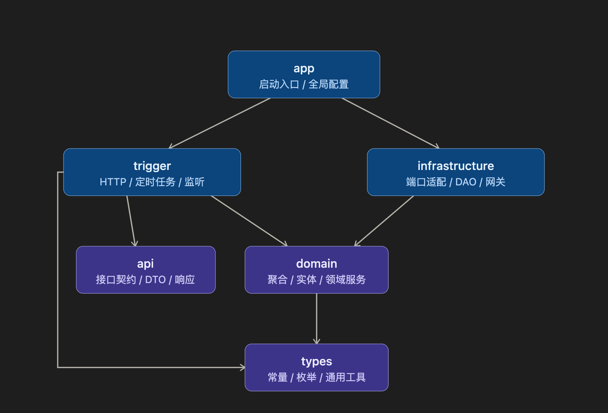
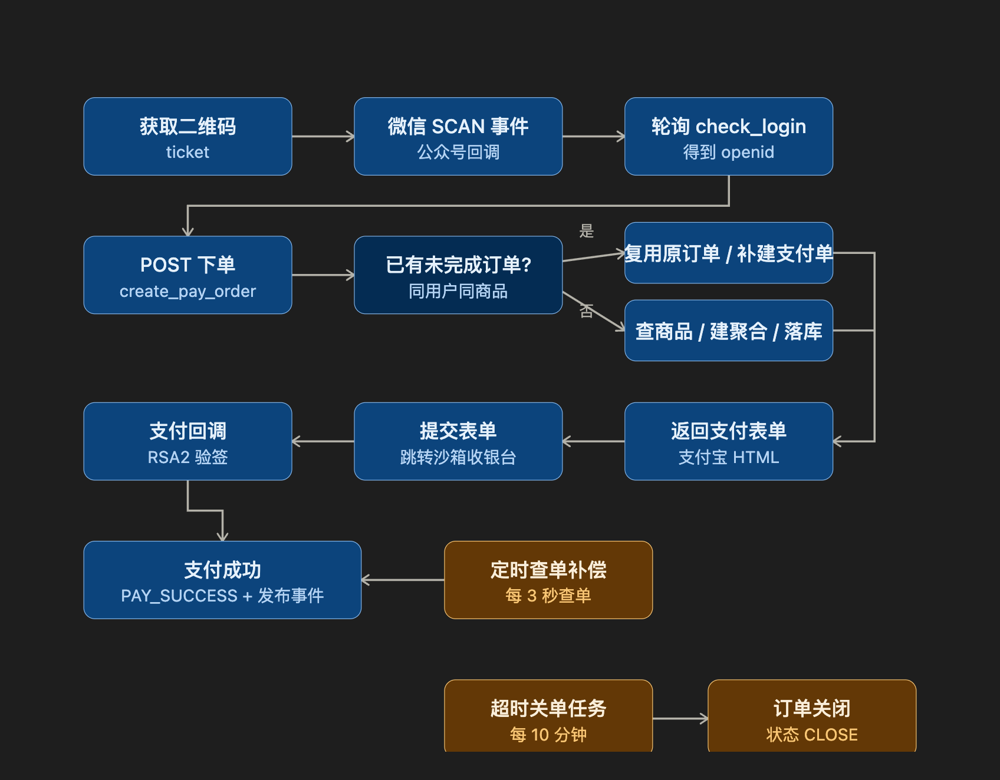

# small-pay-mall-ddd

基于 Spring Boot 3 与 DDD 分层的小额支付商城示例，串联微信扫码登录、商品下单、支付宝沙箱支付与回调、订单定时补偿。

[](./pom.xml)
[](./pom.xml)
[](./pom.xml)

## 目录

- [项目简介](#项目简介)
- [主要功能](#主要功能)
- [安装与依赖](#安装与依赖)
- [快速开始](#快速开始)
- [使用示例](#使用示例)
- [配置说明](#配置说明)
- [目录结构](#目录结构)

## 项目简介

`small-pay-mall-ddd` 是一个多模块的 Java 后端示例工程，用 DDD 分层组织「登录 → 下单 → 支付 → 回调 → 订单补偿」这条链路。对外提供
HTTP 接口，对内通过领域服务编排业务，通过端口（Port）与适配器隔离外部依赖。

需要先明确它的定位，避免误用：

| 维度     | 实际情况                                                                                               | 依据                                                                                                                                                                                                                                              |
|----------|--------------------------------------------------------------------------------------------------------|---------------------------------------------------------------------------------------------------------------------------------------------------------------------------------------------------------------------------------------------------|
| 商品数据 | 来自 `ProductRPC` 的模拟实现，固定返回「测试商品」、价格 `1.68` 元                                     | [ProductRPC.java](./small-pay-mall-ddd-infrastructure/src/main/java/com/junzhecai/infrastructure/gateway/ProductRPC.java)                                                                                                                         |
| 支付渠道 | 支付宝**沙箱**网关 `openapi-sandbox.dl.alipaydev.com`，下单方式为电脑网站支付 `FAST_INSTANT_TRADE_PAY` | [application-dev.yml](./small-pay-mall-ddd-app/src/main/resources/application-dev.yml)、[PayPort.java](./small-pay-mall-ddd-infrastructure/src/main/java/com/junzhecai/infrastructure/adapter/port/PayPort.java)                                  |
| 登录渠道 | 通过 Retrofit 调用微信公众平台接口 `https://api.weixin.qq.com/`，生成带参数二维码并处理 `SCAN` 事件    | [Retrofit2Config.java](./small-pay-mall-ddd-app/src/main/java/com/junzhecai/config/Retrofit2Config.java)、[IWeixinApiService.java](./small-pay-mall-ddd-infrastructure/src/main/java/com/junzhecai/infrastructure/gateway/IWeixinApiService.java) |
| 消息机制 | 支付成功消息由 Guava `EventBus` 在**进程内**发布，监听器目前只打印日志                                 | [GuavaConfig.java](./small-pay-mall-ddd-app/src/main/java/com/junzhecai/config/GuavaConfig.java)、[OrderPaySuccessListener.java](./small-pay-mall-ddd-trigger/src/main/java/com/junzhecai/trigger/listener/OrderPaySuccessListener.java)          |

因此它适合用于学习 DDD 分层、支付回调验签与订单状态流转，或作为本地联调样例；发货、真实商品库、生产支付参数等能力需要自行扩展。

### 工程速览

| 项目              | 值                                                                                                                         |
|-------------------|----------------------------------------------------------------------------------------------------------------------------|
| 坐标              | `com.junzhecai:small-pay-mall-ddd:1.0-SNAPSHOT`（父工程 `packaging=pom`，6 个子模块）                                      |
| 启动模块 / 启动类 | `small-pay-mall-ddd-app` / `com.junzhecai.Application`                                                                     |
| 编译版本          | Java 17（`java.version`、`maven.compiler.source/target`）                                                                  |
| 父依赖            | `spring-boot-starter-parent:3.4.3`                                                                                         |
| 默认 profile      | `prod`（[application.yml](./small-pay-mall-ddd-app/src/main/resources/application.yml) 中 `spring.profiles.active: prod`） |
| 端口              | `dev` 为 8080，`test` / `prod` 为 8091                                                                                     |
| 数据库            | MySQL 库 `s_pay_mall`，仅一张业务表 `pay_order`                                                                            |
| 打包产物          | `small-pay-mall-ddd-app/target/small-pay-mall-ddd-app.jar`                                                                 |

### 模块依赖与分层

下图表示各模块 POM 中的依赖方向，`app` 负责装配与启动，`trigger` 负责外部触发，`domain` 不依赖具体技术实现。



> 说明：图中箭头均表示各模块 `pom.xml` 中的 Maven 依赖方向；`api` 定义的 `IAuthService`、`IPayService` 由 `trigger` 中的
> Controller 实现，`types` 被 `domain`、`trigger` 等模块复用。

## 主要功能

| 能力           | 说明                                                                                                                                                                                       | 关键代码                                                                                                                                                                                                                                                                                                                                                                           |
|----------------|--------------------------------------------------------------------------------------------------------------------------------------------------------------------------------------------|------------------------------------------------------------------------------------------------------------------------------------------------------------------------------------------------------------------------------------------------------------------------------------------------------------------------------------------------------------------------------------|
| 微信扫码登录   | 调用 `cgi-bin/qrcode/create` 生成 `QR_SCENE` 临时二维码（`expire_seconds=2592000`、`scene_id=100601`）；公众号 `SCAN` 事件回调后保存 `ticket → openid`，前端轮询获取登录态，并发送模板消息 | [LoginController.java](./small-pay-mall-ddd-trigger/src/main/java/com/junzhecai/trigger/http/LoginController.java)、[WeixinPortalController.java](./small-pay-mall-ddd-trigger/src/main/java/com/junzhecai/trigger/http/WeixinPortalController.java)、[LoginPort.java](./small-pay-mall-ddd-infrastructure/src/main/java/com/junzhecai/infrastructure/adapter/port/LoginPort.java) |
| 商品查询与下单 | 入参 `userId`、`productId`；优先复用同用户同商品的 `CREATE` / `PAY_WAIT` 订单，否则生成 14 位数字订单号并落库，避免重复下单                                                                | [AbstractOrderService.java](./small-pay-mall-ddd-domain/src/main/java/com/junzhecai/domain/order/service/impl/AbstractOrderService.java)、[CreateOrderAggregate.java](./small-pay-mall-ddd-domain/src/main/java/com/junzhecai/domain/order/model/aggregate/CreateOrderAggregate.java)                                                                                              |
| 创建支付单     | 使用 `AlipayTradePagePayRequest` 请求沙箱网关，`pageExecute` 返回的支付表单 HTML 作为 `payUrl` 写入订单并返回给前端                                                                        | [PayPort.java](./small-pay-mall-ddd-infrastructure/src/main/java/com/junzhecai/infrastructure/adapter/port/PayPort.java)、[OrderService.java](./small-pay-mall-ddd-domain/src/main/java/com/junzhecai/domain/order/service/impl/OrderService.java)                                                                                                                                 |
| 支付回调与验签 | 三个等价回调路径只处理 `TRADE_SUCCESS`；用 `AlipaySignature.rsa256CheckContent` 与支付宝公钥验签，通过后更新订单为支付成功                                                                 | [AlipayController.java](./small-pay-mall-ddd-trigger/src/main/java/com/junzhecai/trigger/http/AlipayController.java)                                                                                                                                                                                                                                                               |
| 掉单补偿       | 每 3 秒扫描下单超过 1 分钟仍为 `PAY_WAIT` 的订单（最多 10 条），调用 `alipay.trade.query` 查单，`TRADE_SUCCESS` / `TRADE_FINISHED` 时补更新                                                | [NoPayNotifyOrderJob.java](./small-pay-mall-ddd-trigger/src/main/java/com/junzhecai/trigger/job/NoPayNotifyOrderJob.java)、[pay_order_mapper.xml](./small-pay-mall-ddd-app/src/main/resources/mybatis/mapper/pay_order_mapper.xml)                                                                                                                                                 |
| 超时关单       | 每 10 分钟扫描下单超过 30 分钟仍未支付的订单（最多 50 条），状态改为 `CLOSE`                                                                                                               | [TimeoutCloseOrderJob.java](./small-pay-mall-ddd-trigger/src/main/java/com/junzhecai/trigger/job/TimeoutCloseOrderJob.java)                                                                                                                                                                                                                                                        |
| 支付成功事件   | 更新订单后构建 `pay_success` 事件消息并经 `EventBus` 发布，监听器日志记录「发货、充值、开会员」扩展点                                                                                      | [OrderRepository.java](./small-pay-mall-ddd-infrastructure/src/main/java/com/junzhecai/infrastructure/adapter/repository/OrderRepository.java)、[PaySuccessMessageEvent.java](./small-pay-mall-ddd-domain/src/main/java/com/junzhecai/domain/order/event/PaySuccessMessageEvent.java)                                                                                              |
| 静态演示页     | `nginx/html` 下提供登录页、商品页、支付表单样例，可直接用静态服务器托管                                                                                                                    | [login.html](./docs/dev-ops/nginx/html/login.html)、[index.html](./docs/dev-ops/nginx/html/index.html)、[form.html](./docs/dev-ops/nginx/html/form.html)                                                                                                                                                                                                                           |

### 主链路流程

下图展示从扫码登录到支付成功的完整链路，以及掉单补偿与超时关单两条定时旁路。



### 订单状态

状态值定义于 [OrderStatusVO.java](./small-pay-mall-ddd-domain/src/main/java/com/junzhecai/domain/order/model/valobj/OrderStatusVO.java)
，落库为 `pay_order.status` 字符串。

| 状态          | 含义                                                     | 触发位置                                       |
|---------------|----------------------------------------------------------|------------------------------------------------|
| `CREATE`      | 创建完成；掉单后可从该状态重新创建支付单                 | `CreateOrderAggregate.buildOrderEntity`        |
| `PAY_WAIT`    | 等待支付；支付单创建后写入                               | `OrderService.doPrepayOrder`                   |
| `PAY_SUCCESS` | 支付成功；回调验签或查单补偿后写入                       | `OrderRepository.changeOrderPaySuccess`        |
| `DEAL_DONE`   | 交易完成（发货完成）；枚举中已定义，当前代码未写入该状态 | —                                              |
| `CLOSE`       | 超时关单                                                 | `TimeoutCloseOrderJob` → `changeOrderPayClose` |

## 安装与依赖

### 环境要求

| 依赖             | 要求                                                      | 依据                                                                                                                               |
|------------------|-----------------------------------------------------------|------------------------------------------------------------------------------------------------------------------------------------|
| JDK              | 17（`maven.compiler.source/target=17`）                   | [pom.xml](./pom.xml)                                                                                                               |
| Maven            | 需本地安装；仓库未提供 Maven Wrapper                      | 仓库文件清单                                                                                                                       |
| MySQL            | 8.x 驱动 `com.mysql.cj.jdbc.Driver`，库名 `s_pay_mall`    | [pom.xml](./pom.xml)、[application-dev.yml](./small-pay-mall-ddd-app/src/main/resources/application-dev.yml)                       |
| Docker / Compose | 可选，用于启动 MySQL、phpMyAdmin、Redis 及应用容器        | [docker-compose-environment.yml](./docs/dev-ops/docker-compose-environment.yml)、[Dockerfile](./small-pay-mall-ddd-app/Dockerfile) |
| 微信公众平台参数 | 需要二维码与模板消息能力，且服务器地址可被微信访问        | `weixin.config.*` 配置项                                                                                                           |
| 支付宝沙箱参数   | 需要沙箱 `app_id`、商户私钥、支付宝公钥                   | `alipay.config.*` 配置项                                                                                                           |
| 公网回调地址     | 支付/微信回调需公网可达，仓库提供 natapp 客户端与启动脚本 | [run_natapp.sh](./docs/dev-ops/natapp/run_natapp.sh)                                                                               |

### 主要技术组件

版本以根 [pom.xml](./pom.xml) 的 `dependencyManagement` 与 `parent` 为准。

| 组件                                              | 版本                          | 用途                                                                                                                   |
|---------------------------------------------------|-------------------------------|------------------------------------------------------------------------------------------------------------------------|
| `spring-boot-starter-parent`                      | 3.4.3                         | Spring Boot 基础依赖管理                                                                                               |
| `spring-boot-starter-web`                         | 随父 POM                      | HTTP 接口与内嵌容器                                                                                                    |
| `mybatis-spring-boot-starter`                     | 3.0.4                         | `pay_order` 表持久化                                                                                                   |
| `mysql-connector-java`                            | 8.0.28                        | MySQL 驱动                                                                                                             |
| `alipay-sdk-java`                                 | 4.38.157.ALL                  | 沙箱下单、查单、回调验签                                                                                               |
| `retrofit` / `converter-jackson`                  | 3.0.0 / 2.9.0                 | 调用微信公众平台 HTTP 接口                                                                                             |
| `fastjson` / `guava` / `commons-lang3`            | 2.0.28 / 32.1.3-jre / 3.9     | JSON、缓存与事件总线、字符串工具                                                                                       |
| `dom4j`                                           | 1.6.1                         | [XmlUtil.java](./small-pay-mall-ddd-types/src/main/java/com/junzhecai/types/sdk/weixin/XmlUtil.java) 解析微信 XML 消息 |
| `lombok`                                          | 随父 POM                      | 简化实体与 DTO 代码                                                                                                    |
| `xstream` / `jjwt` / `java-jwt` / `commons-codec` | 1.4.10 / 0.9.1 / 4.4.0 / 1.15 | 根 POM 已声明；当前 Java 代码中未直接调用                                                                              |
| `spring-boot-starter-test` / `junit`              | 均随父 POM 管理               | 测试依赖（`test` scope）                                                                                               |

> 补充：`docs/dev-ops` 的环境编排包含 Redis 及 redis-admin，但当前业务代码只在 `infrastructure/redis` 保留包声明，没有
> Redis 读写实现。

## 快速开始

以下命令均在仓库根目录执行，示例以**本地开发 profile `dev`（端口 8080）**为准。

### 1. 准备数据库

[SQL 脚本](./docs/dev-ops/mysql/sql/s_pay_mall.sql) 只包含 `pay_order` 的建表语句，需先创建与 JDBC URL 一致的数据库：

```sql
CREATE DATABASE IF NOT EXISTS s_pay_mall DEFAULT CHARACTER SET utf8mb4;
```

```bash
mysql -uroot -p s_pay_mall < docs/dev-ops/mysql/sql/s_pay_mall.sql
```

也可以使用 Compose 启动本地环境（MySQL 容器把 3306 映射为宿主机 13306，root 密码为 `123456`）：

```bash
cd docs/dev-ops
docker compose -f docker-compose-environment.yml up -d
cd ..
```

> 该 Compose 文件引用了 `./mysql/my.cnf` 与 `./redis/redis.conf`，仓库中未提供这两个配置文件，使用前需自行准备或调整挂载；旧版
> Docker 可将 `docker compose` 换成 `docker-compose`。后续步骤仍在仓库根目录执行。

### 2. 配置环境变量

`application-dev.yml` 与 `application-prod.yml` 通过 `${...}` 读取敏感配置。以下均为 **占位符**，请替换为自己的值，且不要提交到版本库：

```bash
export MYSQL_PASSWORD='<数据库密码>'

export WEIXIN_ORIGINALID='<公众号原始ID>'
export WEIXIN_TOKEN='<公众号服务器验证 Token>'
export WEIXIN_APP_ID='<公众号 AppID>'
export WEIXIN_APP_SECRET='<公众号 AppSecret>'
export WEIXIN_TEMPLATE_ID='<登录模板消息 ID>'

export ALIPAY_APP_ID='<支付宝沙箱 AppID>'
export ALIPAY_MERCHANT_PRIVATE_KEY='<商户应用私钥>'
export ALIPAY_PUBLIC_KEY='<支付宝公钥>'
```

同时把 [application-dev.yml](./small-pay-mall-ddd-app/src/main/resources/application-dev.yml) 中
`alipay.config.notify_url` 改为自己可公网访问的回调地址（当前值为仓库内的示例域名）。

### 3. 构建打包

```bash
mvn clean package -DskipTests
```

产物为 `small-pay-mall-ddd-app/target/small-pay-mall-ddd-app.jar`（由 `finalName` 与 Spring Boot 打包插件生成）。`app` 模块的
surefire 插件已设置 `skipTests=true`，默认跳过测试。

### 4. 启动服务

```bash
java -Dspring.profiles.active=dev -jar small-pay-mall-ddd-app/target/small-pay-mall-ddd-app.jar
```

- `dev`：端口 8080，数据库 `127.0.0.1:3306/s_pay_mall`，适合本地直连。
- `prod`：端口 8091，数据库主机为容器服务名 `mysql`，默认 profile，适合在 Compose 网络内运行。
- 若不指定 `-Dspring.profiles.active`
  ，会按 [application.yml](./small-pay-mall-ddd-app/src/main/resources/application.yml) 使用 `prod`。

启动后日志同时输出到控制台与运行目录下的 `./data/log/log_info.log`、`./data/log/log_error.log`
（见 [logback-spring.xml](./small-pay-mall-ddd-app/src/main/resources/logback-spring.xml)）。

### 5. 容器方式（可选）

```bash
mvn clean package -DskipTests
cd small-pay-mall-ddd-app
sh ./build.sh                      # 构建 system/small-pay-mall-ddd-app:1.0-SNAPSHOT
cd ..
docker compose -f docs/dev-ops/docker-compose-app.yml up -d
```

[docker-compose-app.yml](./docs/dev-ops/docker-compose-app.yml) 将容器 8091 端口映射到宿主机
8091；[stop.sh](./docs/dev-ops/app/stop.sh) 用于停止名为 `small-pay-mall-ddd`
的容器。镜像推送由 [push.sh](./small-pay-mall-ddd-app/push.sh) 完成，需要自行提供 `.local-config` 文件。

## 使用示例

### 接口清单

所有路径来自 `trigger` 模块 Controller 的 `@RequestMapping` / `@GetMapping` / `@PostMapping` 组合。

| 方法 | 路径                                                               | 入参                                                     | 返回                                                      |
|------|--------------------------------------------------------------------|----------------------------------------------------------|-----------------------------------------------------------|
| GET  | `/api/v1/login/weixin_qrcode_ticket`                               | 无                                                       | `Response<String>`，`data` 为二维码 `ticket`              |
| GET  | `/api/v1/login/check_login`                                        | `ticket`                                                 | `Response<String>`，`data` 为 `openid`；未登录返回 `0003` |
| GET  | `/api/v1/weixin/portal/receive`                                    | `signature`、`timestamp`、`nonce`、`echostr`             | 验签通过返回 `echostr`，供微信服务器校验                  |
| POST | `/api/v1/weixin/portal/receive`                                    | XML 消息、`signature`、`timestamp`、`nonce`、`openid` 等 | 文本 XML；`SCAN` 事件时保存登录态并回复「登录成功」       |
| POST | `/api/v1/alipay/create_pay_order`                                  | JSON `{ "userId": "...", "productId": "..." }`           | `Response<String>`，`data` 为支付宝支付表单 HTML          |
| POST | `/api/v1/alipay/pay_notify`、`pay_notify_url`、`alipay_notify_url` | 支付宝表单回调参数                                       | 字符串 `success` 或 `failure`                             |

### 完整下单流程（curl）

以 `dev` profile 的 8080 端口为例；若使用默认 `prod`，请把端口换成 8091。

```bash
# 1. 获取微信扫码登录 ticket
curl "http://localhost:8080/api/v1/login/weixin_qrcode_ticket"

# 2. 用返回的 ticket 在浏览器展示二维码
# https://mp.weixin.qq.com/cgi-bin/showqrcode?ticket=<上一步的 ticket>

# 3. 前端轮询登录状态，成功后 data 为 openid，可作为 userId 使用
curl "http://localhost:8080/api/v1/login/check_login?ticket=<ticket>"

# 4. 创建支付单（productId 任意字符串，商品信息由模拟 RPC 返回）
curl -X POST "http://localhost:8080/api/v1/alipay/create_pay_order" \
  -H "Content-Type: application/json" \
  -d '{"userId":"xiaofuge","productId":"10001"}'
```

第 4 步的统一响应结构（[Response.java](./small-pay-mall-ddd-api/src/main/java/com/junzhecai/api/response/Response.java)）：

```json
{
  "code": "0000",
  "info": "成功",
  "data": "<form name=\"punchout_form\" method=\"post\" action=\"...\">...</form>"
}
```

`data` 是可直接插入页面并自动提交的支付宝沙箱表单；[index.html](./docs/dev-ops/nginx/html/index.html)
就是这样处理的。注意两个响应码枚举的成功文案不同：`LoginController` 使用 `types.common.Constants.ResponseCode`（
`调用成功`），`AlipayController` 使用 `types.enums.ResponseCode`（`成功`）。

### 响应码

| code   | 含义                                 | 定义位置                                                                                                                                                                                                        |
|--------|--------------------------------------|-----------------------------------------------------------------------------------------------------------------------------------------------------------------------------------------------------------------|
| `0000` | 成功（文案为「调用成功」或「成功」） | [Constants.java](./small-pay-mall-ddd-types/src/main/java/com/junzhecai/types/common/Constants.java)、[ResponseCode.java](./small-pay-mall-ddd-types/src/main/java/com/junzhecai/types/enums/ResponseCode.java) |
| `0001` | 调用失败 / 未知失败                  | 同上两处枚举                                                                                                                                                                                                    |
| `0002` | 非法参数                             | 同上两处枚举                                                                                                                                                                                                    |
| `0003` | 未登录                               | 仅 `Constants.ResponseCode`                                                                                                                                                                                     |

### 支付回调

支付宝以表单参数回调
`alipay_notify_url`。[AlipayController.java](./small-pay-mall-ddd-trigger/src/main/java/com/junzhecai/trigger/http/AlipayController.java)
的处理顺序为：仅当 `trade_status=TRADE_SUCCESS` 时继续 → 用支付宝公钥做 RSA2 验签 → 读取并记录 `subject`、`trade_status`、
`trade_no`、`out_trade_no`、`total_amount`、`buyer_id`、`gmt_payment`、`buyer_pay_amount` → 以 `out_trade_no` 更新订单。验签失败或异常返回
`failure`。

### 静态演示页

`docs/dev-ops/nginx/html/` 下有 `login.html`（二维码 + 轮询）、`index.html`（商品 + 下单按钮）、`form.html`
（一次沙箱支付表单的抓取样例）。页面里硬编码了示例域名和 `localhost:8092` 等地址，使用时需按实际服务地址与端口修改；
`form.html` 内含历史签名，只作格式参考，不用于真实下单。

## 配置说明

### Profile 与端口

配置文件位于
`small-pay-mall-ddd-app/src/main/resources/`。[application.yml](./small-pay-mall-ddd-app/src/main/resources/application.yml)
中声明 `spring.config.name: small-pay-mall-ddd-app`，并默认激活 `prod`。

| 文件                                                                                     | 端口 | 数据源                                | 其他配置                                       |
|------------------------------------------------------------------------------------------|------|---------------------------------------|------------------------------------------------|
| [application-dev.yml](./small-pay-mall-ddd-app/src/main/resources/application-dev.yml)   | 8080 | `127.0.0.1:3306/s_pay_mall`           | 线程池、微信、支付宝、MyBatis、日志齐全        |
| [application-test.yml](./small-pay-mall-ddd-app/src/main/resources/application-test.yml) | 8091 | 数据源配置被注释                      | 仅线程池与日志；MyBatis 配置同样被注释         |
| [application-prod.yml](./small-pay-mall-ddd-app/src/main/resources/application-prod.yml) | 8091 | `mysql:3306/s_pay_mall`（容器服务名） | 与 `dev` 相同的微信、支付宝、MyBatis、日志配置 |

### 环境变量

`dev` 与 `prod` 使用同一组环境变量占位符：

| 变量                          | 对应配置项                           | 用途                          |
|-------------------------------|--------------------------------------|-------------------------------|
| `MYSQL_PASSWORD`              | `spring.datasource.password`         | 数据库密码（用户名为 `root`） |
| `WEIXIN_ORIGINALID`           | `weixin.config.originalid`           | 回复消息中的 `FromUserName`   |
| `WEIXIN_TOKEN`                | `weixin.config.token`                | 公众号服务器验证签名          |
| `WEIXIN_APP_ID`               | `weixin.config.app-id`               | 获取 `access_token`、缓存键   |
| `WEIXIN_APP_SECRET`           | `weixin.config.app-secret`           | 获取 `access_token`           |
| `WEIXIN_TEMPLATE_ID`          | `weixin.config.template_id`          | 登录成功模板消息              |
| `ALIPAY_APP_ID`               | `alipay.config.app_id`               | 构造 `AlipayClient`           |
| `ALIPAY_MERCHANT_PRIVATE_KEY` | `alipay.config.merchant_private_key` | 请求签名                      |
| `ALIPAY_PUBLIC_KEY`           | `alipay.config.alipay_public_key`    | 回调验签                      |

### 关键配置项

| 配置键                                | `dev` / `prod` 中的值                                                   | 说明                                                                                                                                                                                                       |
|---------------------------------------|-------------------------------------------------------------------------|------------------------------------------------------------------------------------------------------------------------------------------------------------------------------------------------------------|
| `spring.datasource.driver-class-name` | `com.mysql.cj.jdbc.Driver`                                              | HikariCP 连接池，最大连接数 25、最小空闲 15                                                                                                                                                                |
| `mybatis.mapper-locations`            | `classpath:/mybatis/mapper/*.xml`                                       | 映射文件为 [pay_order_mapper.xml](./small-pay-mall-ddd-app/src/main/resources/mybatis/mapper/pay_order_mapper.xml)                                                                                         |
| `mybatis.config-location`             | `classpath:/mybatis/config/mybatis-config.xml`                          | 当前配置内 `typeAliases` 为空                                                                                                                                                                              |
| `thread.pool.executor.config`         | 核心 20、最大 50、`keep-alive-time` 5000、队列 5000、`CallerRunsPolicy` | 配置类 [ThreadPoolConfigProperties.java](./small-pay-mall-ddd-app/src/main/java/com/junzhecai/config/ThreadPoolConfigProperties.java) 的默认值为最大 200、`keepAliveTime` 10、`AbortPolicy`，会被 yml 覆盖 |
| `alipay.config.gateway_url`           | `https://openapi-sandbox.dl.alipaydev.com/gateway.do`                   | 沙箱网关                                                                                                                                                                                                   |
| `alipay.config.sign_type`             | `RSA2`                                                                  | 签名算法                                                                                                                                                                                                   |
| `alipay.config.notify_url`            | 仓库内为示例公网域名                                                    | 需改为自己的可访问回调地址                                                                                                                                                                                 |
| `alipay.config.return_url`            | `https://gaga.plus`                                                     | 支付完成跳转页；模板消息链接同样使用该地址                                                                                                                                                                 |
| `logging.config`                      | `classpath:logback-spring.xml`                                          | 日志级别 `info`                                                                                                                                                                                            |

`AlipayProperties` 还提供未在 yml 中配置的默认值：`connectTimeout=10000`、`readTimeout=30000`。yml 中的
`alipay.config.enabled: true` 在该配置类中没有对应字段，且类上标注了 `ignoreInvalidFields = true`，因此它当前不控制任何开关行为。

### 缓存与定时任务

[GuavaConfig.java](./small-pay-mall-ddd-app/src/main/java/com/junzhecai/config/GuavaConfig.java) 定义三个本地缓存：

| Bean                | 写入后过期时间 | 使用情况                       |
|---------------------|----------------|--------------------------------|
| `weixinAccessToken` | 2 小时         | 缓存微信 `access_token`        |
| `openidToken`       | 1 小时         | 缓存 `ticket → openid` 登录态  |
| `cache`             | 3 秒           | 已定义，当前业务代码未注入使用 |

`@EnableScheduling` 在 [Application.java](./small-pay-mall-ddd-app/src/main/java/com/junzhecai/Application.java) 上开启：

| 任务                   | cron             | 行为                                  |
|------------------------|------------------|---------------------------------------|
| `NoPayNotifyOrderJob`  | `0/3 * * * * ?`  | 每 3 秒查掉单订单，向支付宝查单并补偿 |
| `TimeoutCloseOrderJob` | `0 0/10 * * * ?` | 每 10 分钟关闭超时未支付订单          |

## 目录结构

```
small-pay-mall-ddd/
├── pom.xml                                  # 父 POM：模块、依赖版本、插件、profiles
├── README.md
├── docs/
│   ├── asset/                               # README 配图：img01.png、img02.png
│   └── dev-ops/                             # 运维编排与演示资源
│       ├── app/                             # 容器启停脚本
│       │   ├── start.sh
│       │   └── stop.sh
│       ├── docker-compose-app.yml           # 应用容器编排
│       ├── docker-compose-environment.yml   # MySQL / phpMyAdmin / Redis 环境编排
│       ├── docker-compose-environment-aliyun.yml  # 使用阿里云镜像仓库的同类编排
│       ├── mysql/sql/s_pay_mall.sql         # pay_order 建表脚本
│       ├── natapp/                          # 内网穿透客户端 config.ini、natapp、run_natapp.sh
│       └── nginx/html/                      # 静态演示页
│           ├── index.html
│           ├── login.html
│           ├── form.html
│           └── images/                      # placeholder.png、sku-keyboard-001.png
├── small-pay-mall-ddd-api/                  # 接口契约：IAuthService、IPayService、DTO、Response
├── small-pay-mall-ddd-app/                  # 启动模块：Application、config、resources、Docker 脚本
├── small-pay-mall-ddd-domain/               # 领域层：聚合、实体、值对象、领域服务、端口接口
├── small-pay-mall-ddd-infrastructure/       # 基础设施层：端口适配、DAO/PO、外部网关、配置属性
├── small-pay-mall-ddd-trigger/              # 触发层：Controller、定时任务、事件监听器
└── small-pay-mall-ddd-types/                # 通用层：常量、枚举、异常、事件基类、微信 XML 工具
```

各模块的职责与依赖（依据各自 `pom.xml`）：

| 模块             | 职责                          | 主要包                                                           | 依赖的模块                  |
|------------------|-------------------------------|------------------------------------------------------------------|-----------------------------|
| `api`            | 对外契约与数据结构            | `com.junzhecai.api`、`dto`、`response`                           | 无内部模块依赖              |
| `types`          | 通用类型与工具                | `common`、`enums`、`event`、`exception`、`sdk.weixin`            | 无内部模块依赖              |
| `domain`         | 业务规则、聚合与端口定义      | `domain.auth`、`domain.order`                                    | `types`                     |
| `infrastructure` | 端口实现、持久化、第三方网关  | `adapter.port`、`adapter.repository`、`dao`、`gateway`、`config` | `domain`                    |
| `trigger`        | HTTP 入口、定时任务、事件监听 | `trigger.http`、`trigger.job`、`trigger.listener`                | `api`、`domain`、`types`    |
| `app`            | 启动装配与全局配置            | `com.junzhecai`、`config`、`resources`                           | `trigger`、`infrastructure` |


